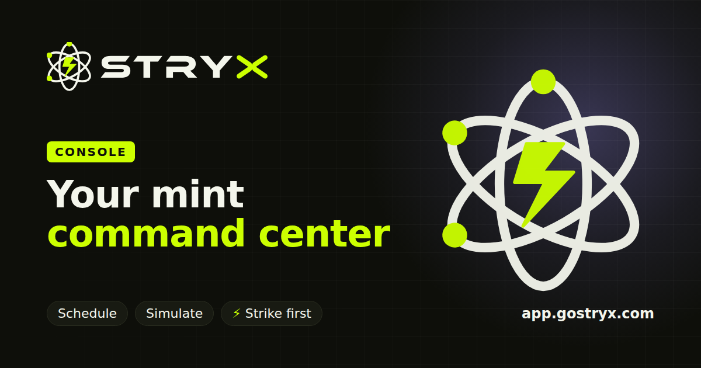

# Stryx

Stryx mints NFT drops from many wallets at once, on a schedule, across EVM chains. It holds the
wallets for you, checks each one's eligibility before anything is signed, and fires the moment a
stage opens.



## Status and risk

Stryx is custodial software: it stores wallet private keys (encrypted) and signs transactions with
them. It is under active development and has not had an independent security audit. If you run it,
you are responsible for the keys and funds it holds. Use it at your own risk, start with small
amounts, and read [how keys are held](#security) first.

## What it does

- **Wallets.** Generate wallets in bulk or import your own. Keys are envelope-encrypted, with the
  master key held in a KMS (AWS KMS in production). Export or delete a wallet at any time.
- **Minting.** Paste an OpenSea link, a collection slug or a contract address. Stryx lists every
  phase of the drop (public, allow-list, signed), shows which wallets may mint and how many, and
  simulates the real mint before it signs.
- **Scheduling.** Mint now, at a set time, or automatically when a stage opens. A scheduled job
  never runs twice.
- **Funding.** Send gas to many wallets in one go, from a Stryx wallet or your own browser wallet.
- **Moving NFTs out.** Transfer what your wallets hold to one destination.
- **Safety.** A per-account and a global emergency stop, daily spend caps per account, chain and
  wallet, an append-only audit log, and a mint log that records every attempt before it is signed.
- **Accounts.** Invite codes with wallet sign-in, an admin overview, and a waitlist with email
  invites.

Supported chains: Ethereum, Base, Arbitrum One, Optimism, Polygon, BNB Chain, Avalanche, Abstract,
Ink, Berachain, Monad, HyperEVM, Ronin, Arc and Robinhood Chain. Minting works where the SeaDrop
contract is deployed; `npm run chains:doctor` reports what works on each chain you configure.

Eligibility checks for signed allow-list stages need an optional module that is not part of this
repository. Without it those checks report as switched off; everything else works.

## How it is built

A TypeScript monorepo (npm workspaces). The API hosts every service in one process.

```
apps/
  api/          Fastify API: routes, schedulers, and the wiring for everything below
  dashboard/    The app (React, Vite, TanStack Query)
  landing/      The public site (plain HTML, CSS and JS)

services/
  wallet-service/       Wallet creation, import, ownership and deletion
  transaction-engine/   Gas, simulation, nonce, signing, sending, and the stop and cap checks
  nft-engine/           SeaDrop reads, mint transaction building, receipt parsing
  user-service/         Accounts and profiles

packages/
  security/key-management/   Envelope encryption and the KMS providers
  blockchain/nonce-manager/  Redis-backed nonce allocation
  chains/                    The chain registry and icons
  database/                  Prisma schema and migrations
  config/                    Environment settings, validated at startup
  chain-ui/, toast-ui/       Shared UI pieces
  event-bus/, logger/, utils/

workers/
  eligibility/   Allow-list Merkle trees and proof verification

brand/           Logo, colours and the brand guide
deploy/railway/  Dockerfiles and the Caddy config
docs/            Decision records, the deployment guide, legal drafts
```

It needs Node 22, PostgreSQL and Redis.

## Quick start

```bash
npm install
npm run dev:infra                         # Postgres and Redis in Docker

cp .env.example .env                      # then fill in the values below
ln -s ../../.env apps/api/.env
ln -s ../../.env packages/database/.env

npm run build
npm run db:migrate -w @stryx/database

npm run dev -w @stryx/api                 # http://localhost:3000
npm run dev -w @stryx/dashboard           # http://localhost:5173
npm run dev -w @stryx/landing             # http://localhost:5174, optional
```

Set these in `.env` before the first run:

| Setting | What to put |
| --- | --- |
| `API_AUTH_TOKEN` | Any long random string (`openssl rand -hex 32`). You log in to the dashboard with it. |
| `LOCAL_KMS_KEK` | `openssl rand -hex 32`. Keep it: wallets encrypted under it need it. |
| An RPC URL | At least one chain, for example `RPC_BASE`. |
| `OPENSEA_API_KEY` | Optional. Needed to resolve collection slugs and list allow-list phases. |

Then open the dashboard and log in with the token.

## Checks

```bash
npm run build        # every workspace, in dependency order
npm run typecheck
npm run lint
npm test
```

Some API tests need a real database and are skipped unless one is configured.

## Configuration

Every setting is documented in [`.env.example`](.env.example) and validated in
[`packages/config`](packages/config/src/index.ts); the API refuses to start on a bad value.
The ones that matter most in production:

- `KMS_PROVIDER=aws` and `KMS_KEY_ID`. The local key provider refuses to run in production.
- `RUNTIME_DATABASE_URL`: the API's own lower-privileged database role.
- `TLS_TERMINATED=true`: confirms HTTPS sits in front of the API.
- `APP_ORIGIN` and `ACCESS_CODE_SECRET`: turn on invite codes and wallet sign-in.
- `DEFAULT_DAILY_SPEND_CAP_WEI` and `DEFAULT_DAILY_SPEND_CAPS`: spend limits.
- `SIGNED_MINT_EXECUTION_ENABLED`: off by default.

The migrations create the `stryx_app` and `stryx_analytics` database roles with development
passwords. Change both before the database holds anything real.

## Deploying

[`docs/deployment/RAILWAY.md`](docs/deployment/RAILWAY.md) walks through a full deployment on
Railway: services, private networking, AWS KMS, domains and the checks to run afterwards.
[`infra/aws`](infra/aws) has the KMS key policy.

## Security

- **Keys.** Each wallet's private key is encrypted with its own data key, and that data key is
  wrapped by a master key held in KMS. A raw key exists in memory only for the moment of signing
  and is zeroed straight after. See [ADR-001](docs/adr/ADR-001-wallet-key-custody-and-emergency-stop.md).
- **Ownership.** Every wallet operation is scoped to its owner, and another account's wallet looks
  the same as one that does not exist. See [ADR-002](docs/adr/ADR-002-multi-user-custody-and-authorization.md).
- **Before signing.** Every send passes the emergency stop, the spend cap and a simulation first.
- **Records.** The audit log and the mint log cannot be rewritten by the running app; the database
  enforces it.

To report a vulnerability, please use GitHub's private "Report a vulnerability" form on this
repository instead of opening a public issue.

## Licence

[MIT](LICENSE)
